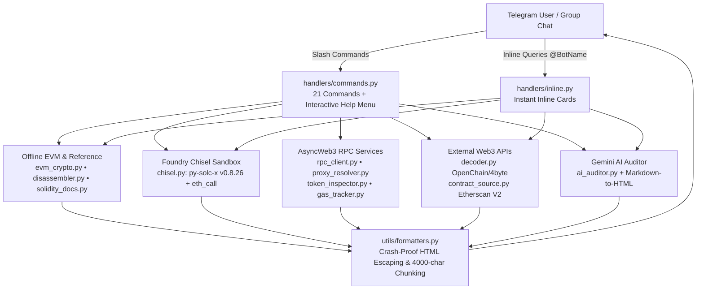

# ⚔️ EVM Swiss Army Knife — Web3 All-in-One Helper Bot

[](https://github.com/reverb006/WEB3-All-In-One-Helper-Bot/actions/workflows/ci.yml)
[](https://www.python.org/downloads/)
[](https://docs.aiogram.dev/)
[](LICENSE)

An all-in-one, async **Web3 & EVM Swiss Army Knife Telegram Bot** built with **Python 3.11+**, **aiogram 3.x**, **Web3.py**, **py-solc-x**, and **Google Gemini**. Designed as an instant on-the-go utility for smart-contract security auditors, protocol researchers, bug bounty hunters, and Solidity engineers.

Supports both **21 interactive slash commands** (with category navigation keyboards) and **Telegram Inline Queries** (`@YourBotName <query>`) directly inside any chat, group, or DM.

---

## 📑 Table of Contents

- [What It Does](#-what-it-does)
- [How It Works](#-how-it-works)
  - [Architecture Overview](#architecture-overview)
  - [Core Engines Under the Hood](#core-engines-under-the-hood)
- [Quick Setup](#-quick-setup)
  - [1. Prerequisites](#1-prerequisites)
  - [2. Clone & Install](#2-clone--install)
  - [3. Configure Environment (`.env`)](#3-configure-environment-env)
  - [4. Run the Bot](#4-run-the-bot)
- [Docker Deployment](#-docker-deployment)
- [Complete Command Reference](#-complete-command-reference)
  - [1. Web3 & Smart Contract AI Auditor](#1-web3--smart-contract-ai-auditor)
  - [2. Calldata & Signature Resolution](#2-calldata--signature-resolution)
  - [3. EVM Math & Unit Conversions](#3-evm-math--unit-conversions)
  - [4. Storage & State Resolvers](#4-storage--state-resolvers)
  - [5. Proxy, Source, Token & Gas Diagnostics](#5-proxy-source-token--gas-diagnostics)
  - [6. Solidity & Foundry Auditor Reference](#6-solidity--foundry-auditor-reference)
  - [7. Foundry Chisel Live Solidity REPL](#7-foundry-chisel-live-solidity-repl)
  - [8. Counterfactual Deployments (`CREATE` / `CREATE2`)](#8-counterfactual-deployments-create--create2)
  - [9. Simulation & Transaction Diagnostics](#9-simulation--transaction-diagnostics)
  - [10. EVM Bytecode Disassembly](#10-evm-bytecode-disassembly)
- [Telegram Inline Queries](#-telegram-inline-queries-use-anywhere)
- [Project Structure](#-project-structure)
- [Testing](#-testing)
- [Security Best Practices](#-security-best-practices)
- [Contributing & License](#-contributing--license)

---

## ✨ What It Does

- **Web3 & Solidity AI Auditor (`/ask`, `/ai`, `/audit`)**: Powered by Google Gemini (`google-genai`) with automatic fallback models and reply-context awareness — reply to any `/revert` trace or code snippet with `/ask` for immediate diagnosis.
- **Foundry Chisel Solidity REPL (`/chisel`, `/eval`, `/solc`, `/ch`)**: Compiles expressions, multi-line statements, custom functions, Yul inline assembly, or full contracts using `solc v0.8.26` and executes them in an `eth_call` sandbox with zero gas spent.
- **Solidity & Foundry Cheatcode Reference (`/sol`, `/solidity`, `/fn`)**: Offline, instant search across **57 curated reference entries** in **12 categories** (special functions, globals, ABI encoding, cryptography, low-level calls, Yul/transient storage, and Foundry `vm.*` cheatcodes) complete with real-world auditor gotchas and examples.
- **Calldata & Custom Error Decoder (`/decode`, `/hash`, `/error`)**: Resolves 4-byte selectors via OpenChain & 4byte Directory, parses nested tuple signatures, decodes ABI arguments, and computes Keccak-256 function/error selectors.
- **Proxy Implementation Resolver (`/proxy`)**: Resolves implementation, admin, and beacon addresses across **EIP-1967**, **EIP-1822 (UUPS)**, **OpenZeppelin Legacy**, and **EIP-897** proxies.
- **Verified Contract Source & ABI (`/source`)**: Queries Etherscan API V2 across all supported chains to return verification status, compiler version, optimization runs, EVM version, license, proxy metadata, and ABI preview.
- **ERC-20 Token Inspector (`/token`)**: Queries `name()`, `symbol()`, `decimals()`, and `totalSupply()` (supporting both standard ABI strings and legacy `bytes32` tokens like `MKR`).
- **Live Gas & Blob Fee Tracker (`/gas`)**: Displays current block utilization, base fee, EIP-1559 priority tiers (Slow/Standard/Fast), and EIP-4844 blob gas pricing.
- **Storage Math & Live State Inspection (`/slot`, `/storage`)**: Calculates dynamic mapping slots (`keccak256(h(key) . slot)`) for `address`, `uint256`, `bytes32`, `bool`, and `string`, and decodes live 32-byte words from `eth_getStorageAt` into `uint256`, `int256`, checksum addresses, booleans, short Solidity strings, and ASCII previews.
- **Counterfactual Deployment Calculator (`/create`, `/create2`)**: Derives deterministic `CREATE` (`RLP([deployer, nonce])`) and `CREATE2` (`0xff ++ deployer ++ salt ++ init_code_hash`) addresses.
- **Simulation & Revert Debugger (`/call`, `/revert`)**: Dry-runs read-only `eth_call`s and diagnoses failed transactions by re-simulating at `blockNumber - 1` to decode `Error(string)`, `Panic(uint256)`, and OpenChain custom errors.
- **EVM Bytecode Disassembler (`/disasm`)**: Disassembles raw bytecode into PC-indexed opcodes with `PUSH1..PUSH32` operands, Dencun (`PUSH0`, `MCOPY`, `TLOAD`, `TSTORE`) and EOF preview instructions, and `JUMPDEST` statistics.
- **Multi-Chain Support**: Works across **Ethereum Mainnet (`eth`)**, **Sepolia (`sepolia`)**, **Base (`base`)**, and **Base Sepolia (`base_sepolia`)**.

---

## ⚙️ How It Works

### Architecture Overview



### Core Engines Under the Hood

1. **Foundry Chisel REPL (`services/chisel.py`)**:
   - Strips Markdown fences, distinguishes expressions vs multi-line statements vs contract/function declarations, and wraps expressions in a `pragma solidity ^0.8.26` contract constructor that returns `abi.encode(<expr>)` via inline assembly `return(...)`.
   - Compiles using `py-solc-x`, traverses the compiler AST (`find_encode_call` + `type_to_abi`) to recover exact return types, estimates gas (`eth_estimateGas`), executes via `eth_call`, and renders a Chisel-style output tree (decimal, hex, ETH/Gwei hints, checksummed addresses, gas).
2. **Proxy Resolver (`services/proxy_resolver.py`)**:
   - Inspects storage slots in priority order: EIP-1967 implementation (`0x360894...`), EIP-1967 admin (`0xb53127...`), EIP-1967 beacon (`0xa3f0ad...`), EIP-1822 UUPS (`0xc5f168...`), OpenZeppelin legacy slots (`0x7050c9...` / `0x10d6a5...`), and falls back to `implementation()` / `admin()` view calls.
3. **Calldata & Revert Diagnostics (`services/decoder.py`, `services/rpc_client.py`)**:
   - Splits nested tuple function signatures cleanly (`parse_function_signature`), resolves selectors against OpenChain and 4byte Directory, and decodes parameters via `eth_abi`.
   - For failed transactions (`/revert`), fetches the receipt and original tx, re-simulates at `blockNumber - 1` (with fallback to `blockNumber`), extracts revert bytes, and decodes `Error(string)`, Solidity `Panic(uint256)` (`0x00`–`0x51`), or OpenChain custom errors.
4. **Crash-Proof Telegram Formatting (`utils/formatters.py`, `services/ai_auditor.py`)**:
   - Escapes dynamic data for Telegram `HTML` parse mode, converts Gemini Markdown + LaTeX math symbols (`clean_latex` + `markdown_to_telegram_html`) into clean HTML `<b>`, `<i>`, `<code>`, `<pre>`, and splits long outputs across line boundaries (`chunk_message`) so Telegram never rejects long traces or audits.

---

## 🚀 Quick Setup

### 1. Prerequisites

- **Python `3.11+`**
- **Telegram Bot Token** from [@BotFather](https://t.me/BotFather) *(required)*
- **Google Gemini API Key** from [Google AI Studio](https://aistudio.google.com/apikey) *(optional, required for `/ask`)*
- **Etherscan API V2 Key** from [Etherscan](https://etherscan.io/apis) *(optional, required for `/source`)*
- **Custom RPC URLs** *(optional — public `publicnode.com` RPC endpoints work out of the box)*

### 2. Clone & Install

**Linux / macOS:**
```bash
git clone https://github.com/reverb006/WEB3-All-In-One-Helper-Bot.git
cd WEB3-All-In-One-Helper-Bot
python3 -m venv .venv
source .venv/bin/activate
pip install -r requirements.txt
cp .env.example .env
```

**Windows (PowerShell):**
```powershell
git clone https://github.com/reverb006/WEB3-All-In-One-Helper-Bot.git
cd WEB3-All-In-One-Helper-Bot
python -m venv .venv
.\.venv\Scripts\Activate.ps1
pip install -r requirements.txt
Copy-Item .env.example .env
```

### 3. Configure Environment (`.env`)

Edit `.env` with your keys. Never commit `.env` to GitHub (it is excluded by `.gitignore`).

| Variable | Required | Default | Description |
|:---|:---:|:---|:---|
| `BOT_TOKEN` | Yes | `""` | Telegram Bot API token from `@BotFather` |
| `RPC_URL_ETH` | No | `https://ethereum-rpc.publicnode.com` | Ethereum Mainnet JSON-RPC endpoint |
| `RPC_URL_ETH_SEPOLIA` | No | `https://ethereum-sepolia-rpc.publicnode.com` | Ethereum Sepolia Testnet JSON-RPC endpoint |
| `RPC_URL_BASE` | No | `https://base-rpc.publicnode.com` | Base Mainnet JSON-RPC endpoint |
| `RPC_URL_BASE_SEPOLIA` | No | `https://base-sepolia-rpc.publicnode.com` | Base Sepolia Testnet JSON-RPC endpoint |
| `ETHERSCAN_API_KEY` | No | `None` | Unified Etherscan API V2 key for `/source` |
| `GEMINI_API_KEY` | No | `None` | Google Gemini API key for `/ask`, `/ai`, `/audit` |
| `GEMINI_MODEL` | No | `gemini-3.8-flash` | Primary Gemini model (with automatic fallback models) |
| `OPENCHAIN_API_URL` | No | `https://api.openchain.xyz/signature-database/v1/lookup` | OpenChain 4-byte signature lookup API |
| `FOURBYTE_API_URL` | No | `https://www.4byte.directory/api/v1/signatures/` | 4byte Directory fallback API |
| `MAX_DISASM_LINES` | No | `80` | Max instruction lines displayed by `/disasm` |

> **Note on `/chisel`:** The first time `/chisel` runs, `py-solc-x` automatically downloads `solc v0.8.26` locally if it is not already installed.

### 4. Run the Bot

**Terminal:**
```bash
python bot.py
```

**Windows One-Click:**
Double-click [`run_bot.bat`](run_bot.bat).

On startup, the bot registers all 21 commands in Telegram's native menu and resolves its `@username` dynamically for `/help` inline examples.

---

## 🐳 Docker Deployment

Run the bot continuously in Docker using the included `Dockerfile` and `docker-compose.yml` (runs as non-root `appuser`):

```bash
# Ensure .env exists first
cp .env.example .env

# Build and start in detached mode
docker compose up -d --build

# View live logs
docker compose logs -f

# Stop container
docker compose down
```

---

## 📖 Complete Command Reference

Supported `[chain]` values for RPC and explorer commands:
- `eth` *(default)* — Ethereum Mainnet
- `sepolia` — Ethereum Sepolia Testnet
- `base` — Base Mainnet
- `base_sepolia` — Base Sepolia Testnet

Send `/start` or `/help` to open the interactive category menu.

---

### 1. Web3 & Smart Contract AI Auditor

#### `/ask <question_or_code>` *(Aliases: `/ai`, `/audit`)*
Instant smart-contract security auditing, vulnerability triage, and EVM explanations powered by Google Gemini.

- **Context-Aware Replies**: Reply to any previous bot message, `/revert` trace, or code snippet with `/ask why did this happen?` (or `/ask` alone) to diagnose it in context.
- **Examples**:
  ```text
  /ask what is reentrancy and how to prevent it?
  /ask difference between call, delegatecall, and staticcall
  /ask audit this function:
  function withdraw() external {
      (bool s,) = msg.sender.call{value: bal}("");
      bal = 0;
  }
  ```

---

### 2. Calldata & Signature Resolution

#### `/decode <calldata>`
Extracts the 4-byte selector, queries OpenChain and 4byte Directory, and ABI-decodes arguments (or shows raw 32-byte words if no signature matches).

```text
/decode 0xa9059cbb000000000000000000000000d8da6bf26964af9d7eed9e03e53415d37aa960450000000000000000000000000000000000000000000000000de0b6b3a7640000
```

#### `/hash <signature>`
Calculates the 4-byte selector and full Keccak-256 hash of a function or event signature (ignores whitespace inside argument lists).

```text
/hash transfer(address,uint256)
```

#### `/error <signature>`
Calculates the 4-byte selector and full Keccak-256 hash for a custom Solidity error.

```text
/error Unauthorized()
/error InsufficientBalance(uint256,uint256)
```

---

### 3. EVM Math & Unit Conversions

#### `/convert <amount> <unit>`
Converts high-precision `Decimal` values across `wei`, `kwei`/`babbage`, `mwei`/`lovelace`, `gwei`/`shannon`, `szabo`, `finney`, and `ether`/`eth`.

```text
/convert 1.5 eth
/convert 50 gwei
/convert 1000000000000000000 wei
```

#### `/hex <integer>`
Converts any positive or negative integer into compact hex and a 256-bit (32-byte) two's complement padded hex word.

```text
/hex 12345
/hex -1
```

#### `/dec <hex_string>`
Converts any hex word into both unsigned `uint256` and signed `int256` (two's complement).

```text
/dec 0x3039
/dec 0xffffffffffffffffffffffffffffffffffffffffffffffffffffffffffffffff
```

---

### 4. Storage & State Resolvers

#### `/slot <key> <slot_number> [key_type]`
Computes dynamic mapping storage slot locations using `keccak256(h(key) . slot)`. Auto-detects `address`, `uint256`, `bytes32`, `bool`, and `string` (or accepts an explicit `key_type`).

```text
/slot 0xd8da6bf26964af9d7eed9e03e53415d37aa96045 0
/slot 1 2 uint256
```

#### `/storage <contract_address> <slot> [chain]`
Reads a 32-byte word via `eth_getStorageAt` and decodes it into raw hex, `uint256`, `int256`, checksummed address (when upper 12 bytes are zero), boolean, Solidity short string, and ASCII preview.

```text
/storage 0xC02aaA39b223FE8D0A0e5C4F27eAD9083C756Cc2 0 eth
/storage 0xYourContractAddress 0 sepolia
```

---

### 5. Proxy, Source, Token & Gas Diagnostics

#### `/proxy <contract_address> [chain]`
Detects upgradeable proxy patterns and resolves logic implementation, proxy admin, and beacon addresses across EIP-1967, EIP-1822 UUPS, OpenZeppelin Legacy, and EIP-897.

```text
/proxy 0xA0b86991c6218b36c1d19D4a2e9Eb0cE3606eB48 eth
```

#### `/source <contract_address> [chain]`
Queries Etherscan API V2 for contract verification status, compiler version, optimization runs, EVM version, license, proxy target, and ABI snippet *(requires `ETHERSCAN_API_KEY`)*.

```text
/source 0xC02aaA39b223FE8D0A0e5C4F27eAD9083C756Cc2 eth
/source 0x4200000000000000000000000000000000000006 base
```

#### `/token <token_address> [chain]`
Inspects ERC-20 `name()`, `symbol()`, `decimals()`, and human-readable `totalSupply()` (supports `bytes32` metadata fallback).

```text
/token 0x6B175474E89094C44Da98b954EedeAC495271d0F eth
/token 0x833589fCD6eDb6E08f4c7C32D4f71b54bdA02913 base
```

#### `/gas [chain]`
Fetches latest block number, block utilization %, base fee, current gas price, Slow/Standard/Fast EIP-1559 tiers, and EIP-4844 blob gas price.

```text
/gas eth
/gas base
```

---

### 6. Solidity & Foundry Auditor Reference

#### `/sol [function_or_keyword]` *(Aliases: `/solidity`, `/fn`)*
Searches 57 built-in Solidity & Foundry reference entries with fuzzy typo suggestions. Call `/sol` with no arguments to browse all 12 categories.

```text
/sol receive
/sol delegatecall
/sol encodePacked
/sol ecrecover
/sol tstore
/sol vm.prank
/sol vm.expectRevert
```

---

### 7. Foundry Chisel Live Solidity REPL

#### `/chisel <expression_or_code>` *(Aliases: `/eval`, `/solc`, `/ch`)*
Compiles Solidity snippets with `solc v0.8.26` and simulates execution via `eth_call`.

```text
/chisel 1 ether / 1 gwei
/chisel type(uint256).max
/chisel keccak256(bytes("hello"))
/chisel uint256 a = 10; uint256 b = 20; a * b
/chisel abi.encodeWithSignature("transfer(address,uint256)", 0xd8dA6BF26964aF9D7eEd9e03E53415D37aA96045, 100)
/chisel function double(uint x) internal pure returns (uint) { return x * 2; } double(21)
```

---

### 8. Counterfactual Deployments (`CREATE` / `CREATE2`)

#### `/create <deployer_address> <nonce>`
Computes deterministic `CREATE` address (`keccak256(rlp([deployer, nonce]))[12:]`).

```text
/create 0x6ac7ea33f8831ea9dcc53393aaa88b25a785dbf0 0
```

#### `/create2 <deployer> <salt> <init_code_or_hash>`
Computes deterministic `CREATE2` address (`keccak256(0xff ++ deployer ++ salt ++ init_code_hash)[12:]`). Automatically hashes raw init code if not already 32 bytes.

```text
/create2 0x5C69bEe701ef814a2B6a3EDD4B1652CB9cc5aA6f 0x0 0x96e8ac4277198ff8b6f785478aa9a39f403cb768dd02cbee326c3e7da348845f
```

---

### 9. Simulation & Transaction Diagnostics

#### `/revert <tx_hash> [chain]`
Fetches a transaction receipt, re-simulates failed calls at `blockNumber - 1`, and decodes `Error(string)`, `Panic(uint256)`, or custom errors via OpenChain.

```text
/revert 0xYourFailedTxHash eth
```

#### `/call <to_address> <calldata> [chain]`
Performs a read-only `eth_call` simulation and prints return hex or decoded revert data.

```text
/call 0xC02aaA39b223FE8D0A0e5C4F27eAD9083C756Cc2 0x06fdde03 eth
```

---

### 10. EVM Bytecode Disassembly

#### `/disasm <hex_bytecode>`
Converts raw creation or runtime bytecode into PC-indexed opcodes, immediate operands, and `JUMPDEST` counts (supports Cancun/Dencun & EOF preview opcodes).

```text
/disasm 6080604052348015600f57600080fd5b50
```

---

## 💡 Telegram Inline Queries (Use Anywhere!)

Type `@YourBotName <query>` inside **any chat, group, or DM** without inviting the bot:

| Feature | Inline Query Example | Output |
|:---|:---|:---|
| **AI Web3 Auditor** | `@YourBotName ask what is an oracle attack?` | Smart-contract security answer via Gemini |
| **Chisel REPL** | `@YourBotName chisel 1 ether / 1 gwei` | Compiled Solidity expression output & gas |
| **Solidity Reference** | `@YourBotName sol receive` or `sol vm.prank` | Syntax, auditor notes & Solidity example |
| **4-Byte Selector** | `@YourBotName 0xa9059cbb` | Matching OpenChain / 4byte signatures |
| **Keccak Selector** | `@YourBotName transfer(address,uint256)` | 4-byte selector & full Keccak-256 hash |
| **Unit Conversion** | `@YourBotName 1.5 eth` or `50 gwei` | Wei, Gwei, and Ether breakdown |
| **Hex / Decimal** | `@YourBotName 0xff` or `255` | `uint256`, `int256`, and 256-bit padded hex |
| **Mapping Slot** | `@YourBotName slot 0xd8da6b... 0` | Calculated mapping slot hex |

> **Tip:** Enable inline mode in `@BotFather` with `/setinline` → select your bot → enter a placeholder like `Search EVM, chisel, sol, ask...`.

---

## 📂 Project Structure

```text
WEB3_Helper/
├── handlers/
│   ├── __init__.py
│   ├── commands.py            # Slash command handlers & interactive category help menu
│   └── inline.py              # Telegram inline query engine (@BotName <query>)
├── services/
│   ├── __init__.py
│   ├── ai_auditor.py          # Google Gemini AI auditor & Markdown-to-Telegram-HTML converter
│   ├── chisel.py              # Foundry Chisel Solidity v0.8.26 REPL & eth_call sandbox
│   ├── contract_source.py     # Etherscan API V2 verified source & ABI client
│   ├── decoder.py             # Calldata parser, OpenChain/4byte lookup, revert decoder
│   ├── disassembler.py        # EVM bytecode disassembler (incl. Dencun/EOF opcodes)
│   ├── evm_crypto.py          # Keccak-256, CREATE, CREATE2, mapping slots, units, int256
│   ├── gas_tracker.py         # Live EIP-1559 & EIP-4844 gas tracker
│   ├── proxy_resolver.py      # EIP-1967, EIP-1822 UUPS, Beacon & OZ legacy proxy resolver
│   ├── rpc_client.py          # AsyncWeb3 RPC client (storage, eth_call, revert diagnosis)
│   ├── solidity_docs.py       # 57 curated Solidity & Foundry reference entries (12 categories)
│   └── token_inspector.py     # ERC-20 metadata & circulating supply inspector
├── utils/
│   ├── __init__.py
│   └── formatters.py          # Safe HTML escaping, code blocks & 4000-char message chunker
├── tests/                     # 51 unit & integration tests
├── .dockerignore
├── .env.example
├── .gitignore
├── bot.py                     # Bot entrypoint, Windows IPv4/UTF-8 setup & command menu registration
├── config.py                  # Pydantic Settings (.env loader)
├── CONTRIBUTING.md
├── docker-compose.yml
├── Dockerfile
├── LICENSE
├── README.md
├── requirements.txt
└── run_bot.bat                # Windows one-click launcher
```

---

## 🧪 Testing

Run the automated test suite anytime:

```bash
python -m pytest tests/ -v
```

- Pure unit tests (crypto, ABI/revert decoding, disassembler, Solidity reference, Markdown-to-HTML formatting, mocked Gemini & Etherscan parsers) run completely offline with zero API keys.
- Live RPC / OpenChain / Etherscan integration tests automatically skip cleanly when offline or when `ETHERSCAN_API_KEY` is unconfigured.

---

## 🔒 Security Best Practices

- **Never commit `.env`**: Keep `BOT_TOKEN`, `GEMINI_API_KEY`, `ETHERSCAN_API_KEY`, and private RPC keys strictly inside `.env` (gitignored).
- **Safe HTML Escaping**: Explorer data, revert reasons, and user inputs pass through `escape_html` before rendering in Telegram HTML parse mode.
- **Read-Only Simulation**: `/call`, `/revert`, and `/chisel` only simulate state via `eth_call` / `eth_estimateGas` — the bot holds no private keys and never signs or broadcasts transactions.
- **Non-Root Container**: `Dockerfile` runs under an unprivileged `appuser`.

---

## 🤝 Contributing & License

- Contributions are welcome! See [CONTRIBUTING.md](CONTRIBUTING.md) for development setup and guidelines.
- Released under the **MIT License** — see [LICENSE](LICENSE).
